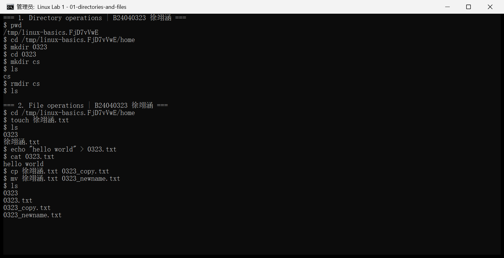
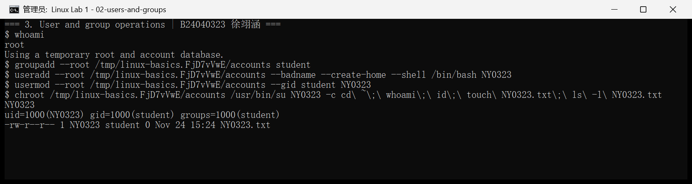
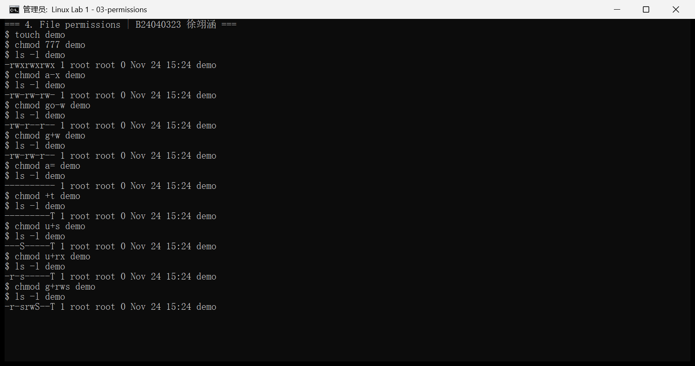
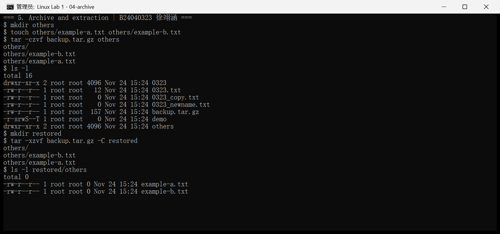
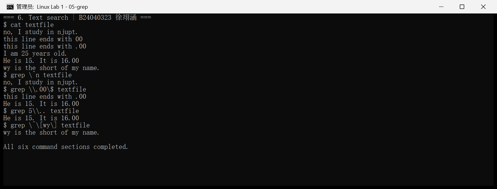

# 实验一 Linux 基本命令

姓名 __________　学号 __________　日期 __________

## 实验目的

在 Ubuntu 中练习目录和文件操作、用户和用户组管理、文件权限、压缩归档及文本检索，并通过命令输出检查结果。

## 实验环境

Windows 上的 WSL 2，Ubuntu 24.04.1 LTS。实验操作集中在新建的临时目录。账户部分使用临时根目录和独立的用户数据库。

## 实验过程与结果

### 1. 目录和文件操作

用 `pwd` 确认位置，进入本次实验的临时主目录后创建 `0323`，再用 `mkdir cs`、`ls`、`rmdir cs` 验证空目录的创建和删除。用 `touch` 创建同名测试文件，将 `hello world` 写入 `0323.txt`，并用 `cat` 读取。复制和重命名后，原文件名消失，`0323_copy.txt` 和 `0323_newname.txt` 均存在，两文件逐字节比较一致。

### 2. 用户和用户组管理

在临时根目录内用 `groupadd` 建立 `student` 组，用非交互的 `useradd` 创建 `NY0323` 和主目录，再用 `usermod -g` 设置主组。WSL 当前用户是 root，实测用 `chroot` 进入隔离的临时根目录，再用 `su` 切换为 `NY0323`。`id` 显示主组为 `student`，`ls -l` 显示新建文件的所有者为 `NY0323`、所属组为 `student`。

### 3. 权限管理

对空文件 `demo` 依次执行题目给出的九次 `chmod`，每次用 `ls -l` 检查。`chmod a=` 清空权限后只设置 sticky 位，末位为 `T`，因为其他用户执行位未设置。设置用户 SUID 且无用户执行位时显示 `S`，再加执行权后变为 `s`。最终权限为 `-r-srwS--T`，这与组 SGID 位已设置、组执行位仍为空相符。

### 4. 打包与解包

在 `others` 目录创建两个样例文件，将整个目录打包压缩为 `backup.tar.gz`。用 `tar -xzvf` 解包到独立的 `restored` 目录，可以看到原目录结构和两个文件。用 `diff -r` 核对两份目录，确认内容一致。

### 5. 文本检索

使用题给的六行 `textfile` 验证四条正则表达式。

| 匹配条件 | 表达式 | 实测结果 |
| --- | --- | --- |
| 以 `n` 开头 | `^n` | 命中第一行 |
| 以字面量 `.00` 结尾 | `\.00$` | 命中第三、第五行 |
| `5` 后接一个句点及任一字符 | `5\..` | 命中第五行 `He is 15. It is 16.00` |
| 以 `w` 或 `y` 开头 | `^[wy]` | 命中第六行 |

## 小结

本实验核对了路径切换、复制与移动的区别，以及文件所有者和主组的关系。权限实验中，同一个特殊权限位会根据对应执行位是否设置显示为大写或小写。正则表达式中 `\.` 匹配字面句点，普通 `.` 匹配任意单个字符。压缩文件解包到新目录后可以用 `diff -r` 验证内容，避免覆盖源目录。

## 复现与证据

在 Ubuntu 中用 `sudo bash run-lab.sh` 运行。脚本在临时根目录执行账号管理，当前运行结束后清理自建的临时目录。[完整实测日志](run-output.txt)由同一轮脚本运行产生。以上图片是将日志按章节在终端中回放后截取的画面。

[课程实验一题目副本](https://github.com/jaraum/linux2026/blob/main/B24060219%E6%B1%AA%E5%98%89%E8%AF%9A/lab1/Experiment%201.pdf)
