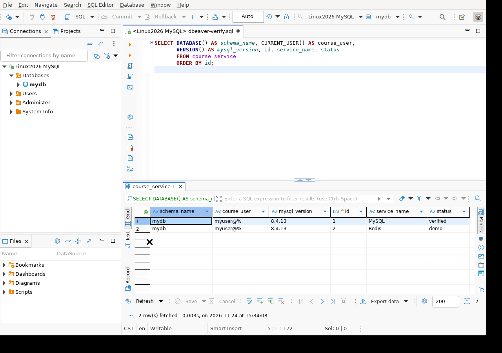

# 课堂实操 MySQL 服务器

## 实验环境

在 Windows 与 Ubuntu 24.04.1 LTS（WSL 2）中用 Docker 运行独立的 MySQL 8.4.13，宿主机访问地址为 `127.0.0.1:13306`。实验库为 `mydb`，字符集为 `utf8mb4`，排序规则为 `utf8mb4_unicode_ci`。

## 实验过程

1. 运行独立 MySQL 容器，使用仅限本机访问的端口。创建课程账号 `myuser`，授予 `mydb.*` 范围内的权限。
2. 用 `myuser` 通过 TCP 连接数据库。执行 [demo.sql](./demo.sql)，建立 `course_service` 表并写入两条测试记录。
3. 查询服务器版本、当前数据库、连接账号和授权范围。再尝试读取 `mysql.user`，验证课程账号无法读取系统账号表。

## 实测结果

连接返回 MySQL 8.4.13 和数据库 `mydb`，状态表查询得到两条预期记录。授权结果只包含 `mydb.*` 的操作权限，读取系统账号表被拒绝。完整命令输出见[实测记录](./实测记录.txt)。

## DBeaver 连接核对

DBeaver 使用 MySQL 驱动连接 `127.0.0.1:13306` 的 `mydb`，以 `myuser` 执行查询。结果表同时显示数据库名、课程账号、服务器版本和两条记录。

