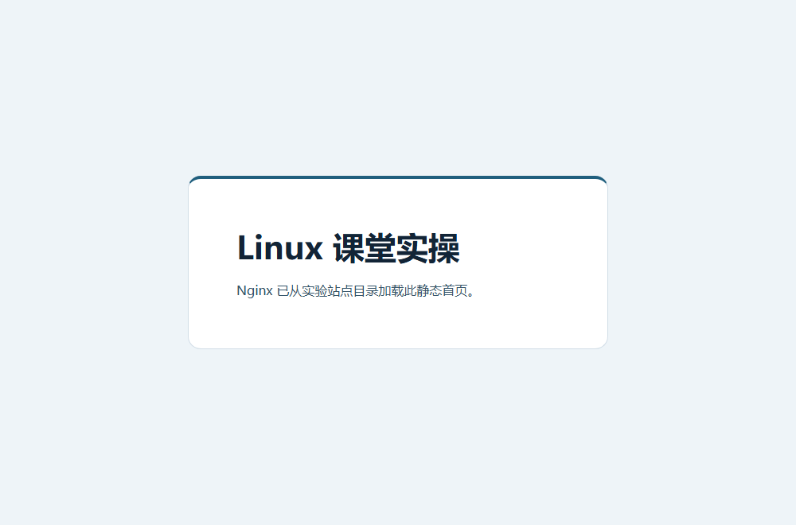

# 课堂实操 SSH 与 Nginx

在 Windows 的 Ubuntu 24.04.1 LTS（WSL 2）中启动测试服务，从 Windows 验证 SSH 登录和网页访问。OpenSSH 与 Nginx 使用 Ubuntu 软件包解压出的程序，服务只监听本机回环地址。

## OpenSSH 远程连接与 Linux 命令

1. 用 `apt-get download openssh-server` 获取 Ubuntu 软件包，再用 `dpkg-deb -x` 解压到实验目录。在独立的挂载命名空间中提供 OpenSSH 进程需要的服务账号。
2. 分别生成实验主机密钥与客户端密钥。监听地址设为 `127.0.0.1`，端口设为 `22222`，用临时授权公钥验证客户端。先执行 `sshd -t -f sshd_config` 检查配置，再启动服务。
3. 在 Windows PowerShell 用 `ssh.exe` 连接 `root@127.0.0.1` 的 22222 端口，使用专用的客户端密钥并核对服务端主机公钥。连接后执行 `whoami`、`pwd`、`uname -s`、`man -w ls` 和 `ls -l`。

登录后返回用户 `root`、当前目录 `/root` 及内核名称 `Linux`。`man -w ls` 返回 `/usr/share/man/man1/ls.1.gz`，`ls -l` 显示实验首页的权限和大小。第一次验证时，OpenSSH 拒绝读取位于 `/tmp` 下的授权文件。将授权文件换到权限合适的临时运行目录后，保持权限检查开启并成功登录。

## Nginx 静态网页部署

1. 用 `apt-get download nginx` 获取软件包，再用 `dpkg-deb -x` 解压到实验目录。
2. 将 [index.html](index.html) 放入实验站点目录 `site/`。在配置中设置 `listen 127.0.0.1:18080`，用 `root` 指向该目录，设 `index index.html`。用 `nginx -t -c nginx.conf` 检查配置再启动实例。
3. Ubuntu 和 Windows 访问 `http://127.0.0.1:18080/` 都收到 `HTTP/1.1 200 OK` 和 `Content-Type: text/html`。在 Ubuntu 用 `cmp` 核对下载响应与部署文件，内容逐字节一致。访问不存在的文件返回 `404`。

Windows Chrome 访问部署后的首页实测截图

[详细运行记录](实测记录.txt)
